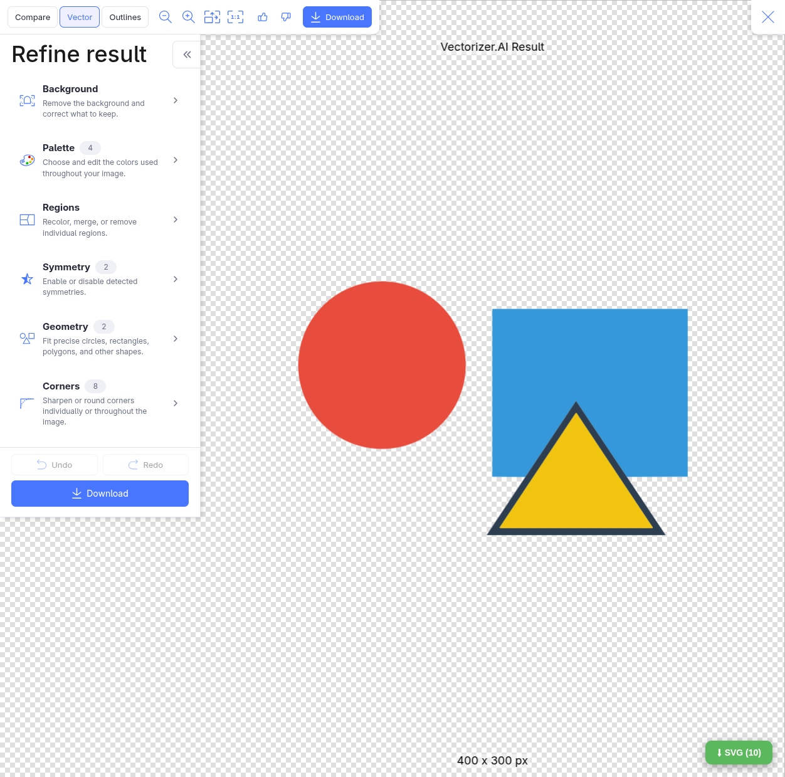
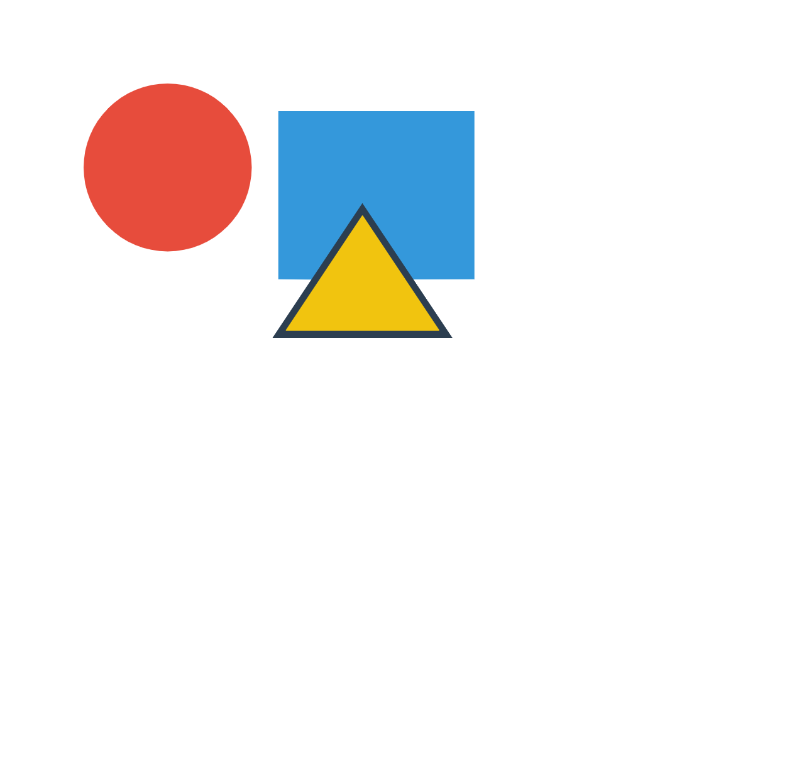

# Vectorizer.AI SVG Export

A Tampermonkey userscript that lets you download the fully vectorized SVG from [vectorizer.ai](https://vectorizer.ai) for free — without a paid download.

## How it works

Vectorizer.AI renders the vectorized result on a `<canvas>` using the `Path2D` API. This script:

1. Patches `window.Path2D` to record every path command (`moveTo`, `lineTo`, `bezierCurveTo`, `arc`, `ellipse`, etc.) as SVG path data.
2. Patches `CanvasRenderingContext2D.fill()` / `stroke()` to capture each drawn path together with its transform matrix, fill/stroke style and alpha.
3. Adds a floating **⬇ SVG** button in the bottom-right corner. Clicking it rebuilds the SVG document (deduplicating preview-pane draws and keeping only the dominant transform), then downloads it as a `.svg` file.

Debug helpers are exposed on `window`:

| Helper | Description |
|---|---|
| `__vzCaptured` | Array of all captured path draws |
| `__vzBuild()` | Rebuilds and returns the `<svg>` element |
| `__vzExport()` | Triggers the download (same as clicking the button) |
| `__vzClear()` | Clears the captured path buffer |
| `__vzMarkers` | Installation progress markers |

## Installation

1. Install a userscript manager in your browser:
   - [Tampermonkey](https://www.tampermonkey.net/) (Chrome, Edge, Firefox, Safari)
   - or [Violentmonkey](https://violentmonkey.github.io/) / [Greasemonkey](https://www.greasespot.net/)
2. Click this link to install the script directly from this repository:

   **[➤ Install `vectorizer-ai-svg-export.user.js`](../../raw/main/vectorizer-ai-svg-export.user.js)**

   Or install manually:
   - Tampermonkey → **Dashboard** → **+** (new script)
   - Paste the contents of [`vectorizer-ai-svg-export.user.js`](vectorizer-ai-svg-export.user.js)
   - Save (`Ctrl+S`)

## Usage

1. Open <https://vectorizer.ai> and upload/vectorize an image.
2. Wait for vectorization to finish — the floating button in the bottom-right corner shows how many paths were captured, e.g. `⬇ SVG (10)`:

   

3. Click the button — the file is downloaded as `*.svg` and opens as real vector art:

   

> **Note:** The script must be active *before* the vectorized result is rendered. If you install/enable it while a result is already on screen, just re-run or re-upload the image.

## Limitations

- Only canvas `Path2D` draws are captured; images or text rendered by other means are not exported.
- `arcTo` and complex transforms are approximated where the canvas API semantics differ from SVG.
- Works against the current vectorizer.ai frontend — a site update may break path capture (check `__vzMarkers` / console for `[vz-export]` logs).

## Credits

Special thanks to **[@keklick1337](https://github.com/keklick1337)** — this project was inspired by and builds upon his [vectorizer.ai-svg-save-from-console](https://github.com/keklick1337/vectorizer.ai-svg-save-from-console) script. 🙏

## Disclaimer

For personal/educational use. Respect vectorizer.ai's terms of service.
